  

  <strong>Useful applications. Thoughtful trading research. Tools that help people build together.</strong> 
  We are developers, traders, and entrepreneurs creating software we want to use ourselves as we work toward financial independence.

  <a href="#what-we-work-on"><strong>What we build</strong></a> &nbsp;·&nbsp;
  <a href="https://x.com/synergymodule">Follow on X / Twitter</a> &nbsp;·&nbsp;
  <a href="https://discord.gg/dhGErPrGny">Join the Discord</a>

---

## What moves us

We build around real workflows: understanding a market, testing an idea, using a tool, and learning from the result. Trading is a major focus today, and we are also exploring applications that make collaboration and everyday work easier.

  

## What we work on

| Focus | What it means for you |
| :-- | :-- |
| **Applications you can use** | Practical workspaces for journaling, market context, practice, and the tasks that surround a trading day. |
| **Agentic trading research** | Assistants and repeatable workflows that organize strategy ideas, evidence, backtests, and forward testing with human review. |
| **Market experiments** | Paper-based exploration and reproducible studies that help us learn from ideas before treating them as products. |
| **Tools for builders** | Shared context, research workflows, and developer tooling that help people and agents collaborate. |

## Find your starting point

<strong>I trade or study markets</strong>

We are building applications around trade journaling, market context, practice, and research. Have a workflow you wish worked better? [Tell us in Discord](https://discord.gg/dhGErPrGny).

<strong>I build software or work with agents</strong>

We are interested in useful interfaces, reliable agent workflows, clear research records, and tools that help small teams move ideas forward. [Meet the team in Discord](https://discord.gg/dhGErPrGny) to discuss building together.

<strong>I have an idea or want to collaborate</strong>

Bring us the problem you want to solve, the workflow you use today, or an experiment you want to test. [Join the conversation](https://discord.gg/dhGErPrGny) and follow [@synergymodule](https://x.com/synergymodule) for updates.

## How we work

**Build something useful. Test it carefully. Keep the evidence. Improve the next version.**

We distinguish backtests, paper results, simulated orders, and live activity. Our aim is to make assumptions, risk checks, and human decisions visible so that users can understand what a tool actually does.

  <a href="#what-we-work-on">Explore our focus areas</a> &nbsp;·&nbsp;
  <a href="https://discord.gg/dhGErPrGny">Talk with us</a> &nbsp;·&nbsp;
  <a href="https://x.com/synergymodule">Follow our progress</a>

We build software and conduct trading research. This page does not promise returns or provide financial advice.
