  

  <strong>Useful applications. Thoughtful trading research. Tools that help people build together.</strong> 
  We are developers, traders, and entrepreneurs creating software we want to use ourselves as we work toward financial independence.

<table align="center" width="100%">
  <tr>
    <td align="center" width="33%">
      <a href="https://x.com/synergymodule">
         
        <strong>X / Twitter</strong>
      </a>
    </td>
    <td align="center" width="34%">
      <a href="https://discord.gg/dhGErPrGny">
         
        <strong>Discord</strong>
      </a>
    </td>
    <td align="center" width="33%">
      <a href="https://whop.com/synergymodule/">
         
        <strong>Whop</strong>
      </a>
    </td>
  </tr>
</table>

---

## What moves us

We build around real workflows: understanding a market, testing an idea, using a tool, and learning from the result. Trading is a major focus today, and we are also exploring applications that make collaboration and everyday work easier.

  

## What we work on

| Focus | What it means for you |
| :-- | :-- |
| **Applications you can use** | Practical workspaces for journaling, market context, practice, and the tasks that surround a trading day. |
| **Agentic trading research** | Assistants and repeatable workflows that organize strategy ideas, evidence, backtests, and forward testing with human review. |
| **Market experiments** | Paper-based exploration and reproducible studies that help us learn from ideas before treating them as products. |
| **Tools for builders** | Shared context, research workflows, and developer tooling that help people and agents collaborate. |

## Find your starting point

<strong>I trade or study markets</strong>

We are building applications around trade journaling, market context, practice, and research. Share the workflow you wish worked better with our community.

<strong>I build software or work with agents</strong>

We are interested in useful interfaces, reliable agent workflows, clear research records, and tools that help small teams move ideas forward. We welcome developers who want to help turn those ideas into working tools.

<strong>I have an idea or want to collaborate</strong>

Bring us the problem you want to solve, the workflow you use today, or an experiment you want to test. Use the community ribbon above to connect with us.

## How we work

**Build something useful. Test it carefully. Keep the evidence. Improve the next version.**

We distinguish backtests, paper results, simulated orders, and live activity. Our aim is to make assumptions, risk checks, and human decisions visible so that users can understand what a tool actually does.

We build software and conduct trading research. This page does not promise returns or provide financial advice.
